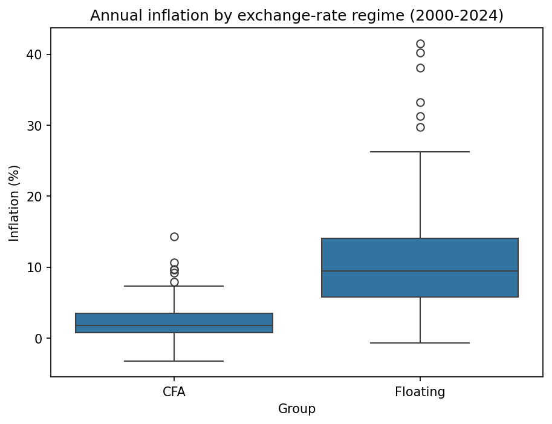
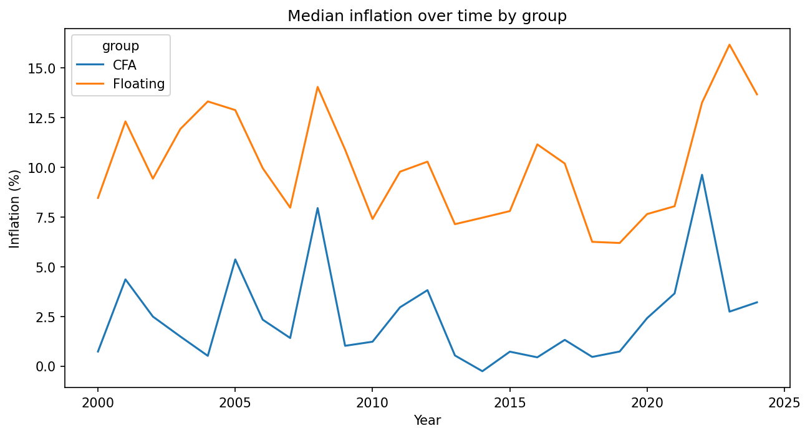
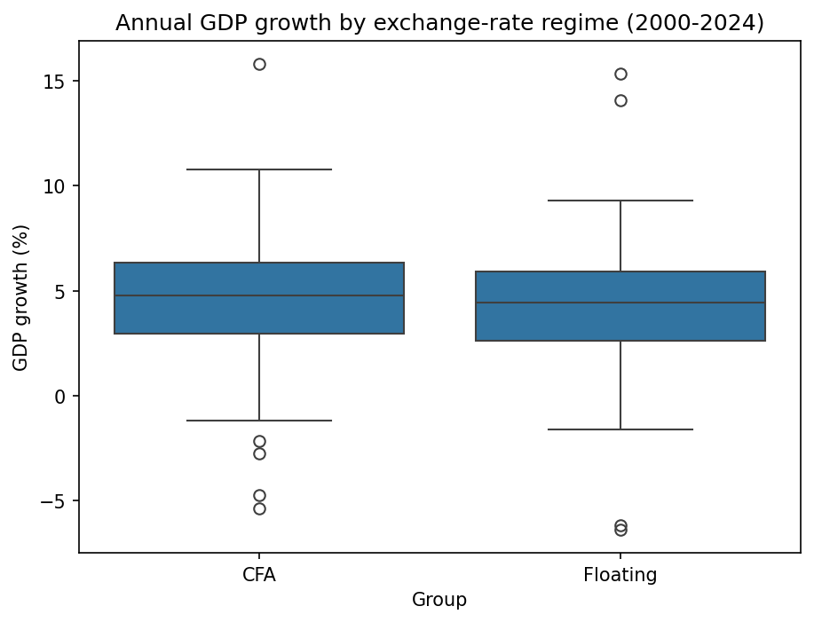

# CFA Franc vs Floating Currencies: Does a Fixed Peg Protect Against Instability?

Statistical comparison of inflation and economic growth between countries of the CFA franc zone (WAEMU) and African countries with floating currencies, 2000-2024.

## Research question
Do CFA zone countries experience lower and more stable inflation than countries with floating currencies, and at what cost in growth?

## Data
- World Bank API: annual inflation (CPI, %) and GDP growth (%), 225 country-year observations.
- CFA zone: Burkina Faso, Cote d'Ivoire, Senegal, Mali, Benin (125 observations).
- Floating: Nigeria, Ghana, Kenya, South Africa (100 observations).

"Floating" is a simplification: Kenya is a managed float, and Nigeria operated multiple exchange rates before 2023.

## Methods
Descriptive statistics, Shapiro-Wilk normality tests, Mann-Whitney U test, Levene test (median-centred), coefficient of variation, chi-square test of independence with Cramer's V, bootstrap confidence interval (resampling whole years), robustness check excluding Ghana and Nigeria. Python: pandas, scipy, statsmodels, seaborn.

## Key findings

| Question | Result |
|---|---|
| Level of inflation | Median 1.76% (CFA) vs 9.44% (floating); Mann-Whitney p < 0.001; probability that a CFA country-year has lower inflation than a floating one = 0.93 |
| Robustness | Without Ghana and Nigeria: medians 1.76% vs 5.93%, p < 0.001 |
| Size of the gap | Difference in medians 7.68 points, 95% bootstrap CI [6.65, 8.49] |
| High-inflation years (> 10%) | 1.6% of CFA country-years vs 43% of floating ones; chi-square p < 0.001, Cramer's V = 0.51 |
| Stability | Variances differ with all countries (Levene p < 0.001) but not without Ghana and Nigeria (p = 0.21); coefficient of variation 1.18 (CFA) vs 0.71 (floating) |
| Growth | Median 4.76% vs 4.42%; no significant difference (p = 0.34) |

**Takeaway:** CFA countries have a markedly and robustly lower level of inflation, with no evidence of a growth penalty. The evidence that they are also more *stable* is mixed.





## Limitations
- Observations are country-years and not independent (repeated countries, common global shocks), so p-values are likely overstated.
- Only 9 countries; results are sensitive to a few of them (Ghana, Nigeria).
- The analysis is descriptive, not causal: it does not control for oil exposure, country size, conflicts or domestic monetary policy.

## Reproduce
```bash
pip install -r requirements.txt
python src/data_collection.py
```
Then run `notebooks/02_descriptive_stats.ipynb`.

## Project structure
- `src/data_collection.py`: downloads the data from the World Bank API
- `notebooks/02_descriptive_stats.ipynb`: full analysis and interpretation
- `data/raw/`: downloaded data
- `figures/`: exported charts